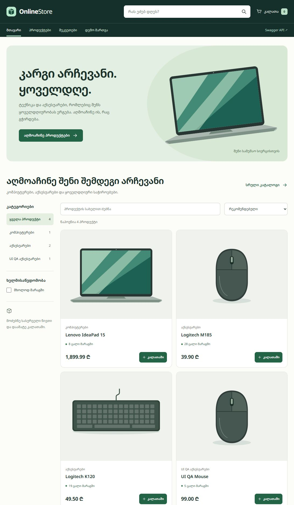

# OnlineStore

ონლაინ მაღაზიის მართვის სასწავლო პროექტი, უნივერსიტეტის `FinalProject.pdf`-ის მიხედვით. შესრულებულია PDF-ის ყველა 20 API ოპერაცია და HttpClient-ის ინტეგრაცია. არსებული Stage 1 solution, ხუთი მოდელი და მონაცემთა ბაზა შენარჩუნებულია. დამატებულია HTML/CSS/Vanilla JavaScript frontend, რომელიც იმავე API პროექტიდან მუშაობს.

## მიმდინარე შედეგი

- Build: 0 შეცდომა, 0 გაფრთხილება.
- ავტომატური ტესტები: **57 წარმატებული, 0 წარუმატებელი, 0 გამოტოვებული**, დამატებით 11 JavaScript ტესტი (კალათა და სურათები).
- ტესტები რეალურ SQL Server-ზე მუშაობს უნიკალურ `OnlineStoreTests_GUID` ბაზებში; განვითარებისთვის გამოყენებული OnlineStoreDb არ იშლება და არ ნულდება.
- Swagger: https://localhost:7156/swagger — 20 სავალდებულო ოპერაცია + 1 ვალუტის კურსის ოპერაცია.
- რეალური გარე მოთხოვნა: HTTP 200, USD→GEL, პროვაიდერის თარიღი 2026-10-29, მიღებული კურსი 2.5915. ეს შემოწმების მომენტის შედეგია და არა მუდმივი მნიშვნელობა.
- ორივე მიგრაცია გამოყენებულია; სქემა მოდელს შეესაბამება.
- GitHub-ზე ატვირთვა სტუდენტის მოთხოვნით გადადებულია. ლოკალური Git ისტორია შექმნილია.

დეტალური მტკიცებულებები: `verification/LiveVerification.json`, `verification/DatabaseVerification.txt`, `verification/FrontendTestSummary.json`, `verification/FrontendBuild.txt`; სრული მიმდინარე TRX: `TestResults/OnlineStore.trx` (Git-ში არ შედის).

მოთხოვნების სტატუსები: [FINAL_REQUIREMENTS_CHECKLIST.md](FINAL_REQUIREMENTS_CHECKLIST.md). პრეზენტაციის ტექსტი: [PROJECT_PRESENTATION.md](PROJECT_PRESENTATION.md).

## პროგრამული გარემო

Windows; Visual Studio Community 2026, ASP.NET and web development workload; .NET 10 SDK; SQL Server 2025 Standard Developer Edition, localhost; SSMS 22; Windows Authentication. ტესტების ანგარიშს SQL Server-ზე დროებითი ბაზების შექმნის/წაშლის უფლება სჭირდება.

პაკეტები: EF Core SQL Server/Design და ლოკალური dotnet-ef 10.0.10; Swashbuckle.AspNetCore 10.3.1; Pkcs 9.0.21 (SQL Client-ის ტრანზიტული უსაფრთხოების შესწორება). ტესტებში: Mvc.Testing 10.0.10, Microsoft.NET.Test.Sdk 17.14.1, xUnit 2.9.3 და Visual Studio runner 3.1.4. სისტემური ინსტალაცია ან გლობალური პარამეტრების შეცვლა პროექტს არ სჭირდება.

## პირველი გაშვება Visual Studio 2026-ში

1. File → Open → Project/Solution → `C:\Projects\OnlineStore\OnlineStore.sln`.
2. Solution Explorer → OnlineStore.API → Set as Startup Project.
3. გაუშვი NuGet Restore. Package Manager Console-ში solution-ის საქაღალდიდან გამოიყენე ქვემოთ მოცემული EF ბრძანება, ან გამოიყენე ჩვეულებრივი PowerShell.
4. აირჩიე **https** პროფილი. F5 ან Ctrl+F5.
5. გაიხსნება https://localhost:7156/ — სრული მაღაზია. Swagger ხელმისაწვდომია https://localhost:7156/swagger-ზე.
6. თუ API უკვე გაშვებულია და პორტი დაკავებულია, ჯერ მიმდინარე პროცესში Ctrl+C გამოიყენე (Visual Studio-ში Shift+F5).

PowerShell:

```powershell
Set-Location C:\Projects\OnlineStore
dotnet tool restore
dotnet restore OnlineStore.sln
dotnet build OnlineStore.sln --no-restore
dotnet ef database update --project OnlineStore.Infrastructure --startup-project OnlineStore.API
dotnet run --project OnlineStore.API --launch-profile https --no-build
```

Swagger მუშაობს Development რეჟიმში, რომელსაც launch profile ადგენს. HTTP 5013 გადადის HTTPS 7156-ზე. OpenAPI JSON: https://localhost:7156/swagger/v1/swagger.json.

არსებული სანდო HTTPS development სერტიფიკატი გამოიყენება. სხვა კომპიუტერზე, თუ ის არ არსებობს, მომხმარებელმა შეიძლება გაუშვას `dotnet dev-certs https --trust` და დაადასტუროს ნდობა. ეს მოქმედება მომხმარებლის სერტიფიკატების საცავს ეხება; ავტომატურად სისტემურ პარამეტრებს არ ვცვლით.

## SQL Server და მიგრაციები

კავშირი ინახება `OnlineStore.API/appsettings.json`-ში:

```text
Server=localhost;Database=OnlineStoreDb;Trusted_Connection=True;TrustServerCertificate=True;
```

Windows Authentication იყენებს აპლიკაციის გამშვები Windows მომხმარებლის უფლებებს. პაროლები/საიდუმლოებები წყაროში არ არის. გარემოს ცვლადი `ConnectionStrings__OnlineStoreDb` კონფიგურაციას საჭიროებისას ცვლის. ტესტები ამ კავშირს დამოუკიდებელი უნიკალური ბაზით ანაცვლებს.

SSMS: Database Engine → localhost → Windows Authentication → Connect → Databases → Refresh → OnlineStoreDb → Tables. ადგილობრივი SQL სერტიფიკატის საჭიროებისას Connection Security-ში Trust server certificate გამოიყენე.

მიგრაციები:

- `20261029200952_InitialCreate` — ხუთი ცხრილი, PK/FK, ინდექსები და CHECK შეზღუდვები.
- `20261029203112_AddReportingObjects` — მხოლოდ დამატებითი View და Stored Procedure; არსებული ცხრილები/მონაცემები არ იცვლება.

მიგრაციები API-ის გაშვებისას ავტომატურად არ გამოიყენება. გამოიყენე `dotnet ef database update` ზემოთ ნაჩვენები project/startup-project-ით. განმეორებითი update უკვე გამოყენებულ მიგრაციებს ხელახლა არ ასრულებს. **არ გამოიყენო database drop ან rollback განვითარების ბაზაზე.** Down მეთოდები მხოლოდ EF-ის გაუქმების ინსტრუქციებია და განვითარების ბაზაზე არ შესრულებულა.

სქემის მხოლოდ წაკითხვით შემოწმება:

```powershell
sqlcmd -S localhost -E -C -d OnlineStoreDb -b -i scripts/VerifyDatabase.sql
```

## მონაცემთა ბაზის სქემა

ყველა Id: int IDENTITY(1,1), Primary Key. Navigation properties ახალი სვეტები არ არის.

| ცხრილი | სხვა სვეტები |
|---|---|
| Products | Name nvarchar(100), Description nvarchar(500), Price decimal(18,2), StockQuantity int, CategoryId int FK |
| Categories | Name nvarchar(100), Description nvarchar(300) |
| Customers | FirstName nvarchar(50), LastName nvarchar(50), Email nvarchar(150), Phone nvarchar(30) NULL |
| Orders | CustomerId int FK, OrderDate datetime2, Status nvarchar(30), TotalAmount decimal(18,2) |
| OrderItems | OrderId int FK, ProductId int FK, Quantity int, UnitPrice decimal(18,2) |

ყველა სხვა სვეტი NOT NULL-ია. პროდუქტსა და კატეგორიაში Description ცარიელი შეიძლება იყოს. Phone არასავალდებულოა. მომხმარებლის email-ს უნიკალური ინდექსი აქვს. Product.Price > 0; Product.StockQuantity >= 0; OrderItem.Quantity > 0 ბაზაშიც CHECK-ებით კონტროლდება. მოთხოვნის ვალიდაცია დამატებით ამოწმებს ტექსტებს, სიგრძეებს, email-სა და ფულისთვის მაქსიმუმ ორ ათწილადს.

კავშირები:

- Category 1 → N Products: Restrict.
- Customer 1 → N Orders: Restrict.
- Product 1 → N OrderItems: Restrict.
- Order 1 → N OrderItems: Cascade.

ამგვარად, შეკვეთაში გამოყენებული პროდუქტი ან შეკვეთიანი მომხმარებელი ვერ წაიშლება; პროდუქტებიანი კატეგორიაც დაცულია. შეკვეთის ნებადართული წაშლისას მისი პოზიციებიც იშლება. `__EFMigrationsHistory` EF-ის ტექნიკური ცხრილია.

სასწავლო SQL ობიექტები (PDF-ში Views/Stored Procedures ჩამოთვლილია, კონკრეტული ფუნქცია დაზუსტებული არ არის):

```sql
SELECT * FROM dbo.vw_CategoryProductSummary;
EXEC dbo.GetOrderDetails @OrderId = 1;
```

View აბრუნებს კატეგორიის პროდუქტების რაოდენობასა და მარაგის ჯამს. პროცედურა აბრუნებს შეკვეთის პოზიციებს ისტორიული UnitPrice-ით. ორივე მიგრაციით იქმნება და ავტომატურ ტესტში სრულდება.

## API-ის ყველა endpoint

| HTTP | გზა | შედეგი |
|---|---|---|
| GET | /api/products | პროდუქტების სია; არასავალდებულო search და categoryId ფილტრები |
| GET | /api/products/{id} | ერთი პროდუქტი |
| POST | /api/products | შექმნა, 201 + Location |
| PUT | /api/products/{id} | განახლება, 200 + მონაცემები |
| DELETE | /api/products/{id} | წაშლა, 204; გამოყენებული პროდუქტი — 409 |
| GET | /api/categories | კატეგორიების სია |
| GET | /api/categories/{id} | ერთი კატეგორია |
| POST | /api/categories | შექმნა, 201 + Location |
| PUT | /api/categories/{id} | განახლება, 200 |
| DELETE | /api/categories/{id} | წაშლა, 204; პროდუქტებიანი — 409 |
| GET | /api/customers | მომხმარებლების სია |
| GET | /api/customers/{id} | ერთი მომხმარებელი |
| POST | /api/customers | შექმნა, 201; დუბლირებული email — 409 |
| PUT | /api/customers/{id} | განახლება, 200; დუბლირებული email — 409 |
| DELETE | /api/customers/{id} | წაშლა, 204; შეკვეთიანი — 409 |
| GET | /api/orders | შეკვეთები პოზიციებით |
| GET | /api/orders/{id} | შეკვეთა პოზიციებით |
| POST | /api/orders | შეკვეთის ატომური შექმნა, 201 |
| PUT | /api/orders/{id}/status | სტატუსის განახლება, 200 |
| DELETE | /api/orders/{id} | ნებადართული შეკვეთის წაშლა, 204 |
| GET | /api/exchange-rates?baseCurrency=USD&targetCurrency=GEL | რეალური გარე ვალუტის კურსი, 200 |

ცალკე OrderItems CRUD endpoint PDF-ში არ მოითხოვება. პოზიციები იქმნება შეკვეთასთან ერთად და შეკვეთის პასუხში ჩანს.

ყველა არარსებული რესურსის GET/PUT/DELETE აბრუნებს 404-ს. არასწორი request — 400. არარსებული შემავალი FK — 400. მარაგის ნაკლებობა, დუბლირებული email, დაუშვებელი სტატუსის ცვლილება ან წაშლა — 409. შეცდომები ერთიანი ProblemDetails ფორმატით ბრუნდება (`status`, `title`, `traceId`; ვალიდაციისას `errors`). მოულოდნელი შეცდომა აბრუნებს უსაფრთხო 500-ს შიდა SQL ტექსტისა და stack trace-ის გარეშე; დეტალი სერვერის ლოგში რჩება.

## Swagger და მოთხოვნების მაგალითები

Swagger-ში გახსენი შესაბამისი მოქმედება → Try it out → შეავსე JSON → Execute. Create-ის პასუხის Id შემდეგ მოთხოვნაში გამოიყენე. Request და response ცალკე DTO-ებითაა აღწერილი, ამიტომ navigation ციკლები/ზედმეტი ჩასაწერი ველები არ გამოჩნდება.

POST /api/categories:

```json
{"name":"ტელეფონები","description":"სმარტფონები"}
```

POST /api/products (categoryId შეცვალე დაბრუნებული რეალური Id-ით):

```json
{"name":"Samsung A35","description":"128GB","price":799.90,"stockQuantity":5,"categoryId":1}
```

POST /api/customers:

```json
{"firstName":"ანა","lastName":"გელაშვილი","email":"ana.demo@example.com","phone":"+995555020202"}
```

POST /api/orders (customerId/productId აიღე შენი პასუხებიდან):

```json
{"customerId":1,"items":[{"productId":1,"quantity":2}]}
```

PUT /api/orders/{id}/status:

```json
{"status":"Cancelled"}
```

სრული 20 მოქმედების ხელით გამოსაყენებელი მაგალითებია `OnlineStore.API/OnlineStore.API.http`-ში. წაშლის მაგალითებში Id თავიდან 0-ია: ჩასვი მხოლოდ შენ მიერ შექმნილი სადემონსტრაციო ჩანაწერის Id.

## შეკვეთები და კონკურენტული მოთხოვნები

შექმნისას სერვისი ამოწმებს მომხმარებელს, თითოეულ პროდუქტს, რაოდენობებსა და ხელმისაწვდომ მარაგს. კლიენტი არ განსაზღვრავს TotalAmount-ს ან UnitPrice-ს: სერვერი კითხულობს ფასს ბაზიდან, ინახავს OrderItem.UnitPrice-ში და ითვლის ჯამს decimal-ით. პროდუქტის შემდგომი ფასის ცვლილება ძველი შეკვეთის თანხას არ ცვლის. რაოდენობები და ჯამი სქემის რიცხვით დიაპაზონში უნდა მოთავსდეს.

შეკვეთა, ყველა პოზიცია და მარაგის შემცირება ერთ ტრანზაქციაში ინახება. SaveChanges-ის შემდეგაც თუ შეცდომა მოხდა Commit-მდე, ყველაფერი rollback-დება — ეს ცალკე ტესტით დადასტურებულია.

`StoreTransaction` იყენებს SQL Server `sp_getapplock`-ს, Exclusive/Transaction რეჟიმში, 10-წამიანი ლოდინით. ყველა აპლიკაციური ჩაწერა ერთსა და იმავე, კონკრეტული ბაზისთვის მოქმედ ბლოკირებას იღებს. ამიტომ სხვადასხვა HTTP მოთხოვნა/აპლიკაციის პროცესიც ვერ დახარჯავს ერთსა და იმავე მარაგს ერთდროულად. ბლოკირება commit/rollback-ზე თავისუფლდება. 12 პარალელური მოთხოვნით, 5-ცალიანი მარაგიდან ზუსტად 5 შეკვეთა შეიქმნა; დანარჩენი 409-ით უარყოფილია. პირდაპირი ხელით SQL ცვლილებები აპლიკაციის კონტრაქტს არ ეკუთვნის.

PDF სტატუსების სრულ სიასა და წაშლის ბიზნესწესს არ განსაზღვრავს. დოკუმენტირებული მარტივი წესი:

- ახალი შეკვეთა: Pending; დრო: UTC.
- Pending → Completed ან Cancelled.
- Completed და Cancelled საბოლოო სტატუსებია; იმავე სტატუსის განმეორება უსაფრთხოა.
- გაუქმება მარაგს ერთხელ აბრუნებს.
- იშლება მხოლოდ Pending/Cancelled. Pending-ის წაშლა მარაგს აბრუნებს; Cancelled-ის წაშლა ხელახლა აღარ აბრუნებს; Completed არ იშლება.
- ერთ შეკვეთაში 1–100 პოზიციაა; ერთი პროდუქტის დუბლირებული პოზიციები 400-ით უარყოფილია. ეს ლიმიტი/დუბლირების წესი PDF-ში დაზუსტებული არ არის და მარტივი request კონტრაქტის დაშვებაა.

## უსაფრთხო დემო მონაცემები

`appsettings.Development.json`: `SeedData:Enabled = true`. Production-ის ძირითადი კონფიგურაცია false-ია; კოდი seeding-ს მხოლოდ Development-ში უშვებს. გამორთვა: development ფაილში false ან გარემოს ცვლადი `SeedData__Enabled=false`.

საწყისი `DevelopmentSeeder` მუშაობს **მხოლოდ სრულიად ცარიელ მაღაზიაზე**. თუ რომელიმე ძირითადი ცხრილი უკვე შეიცავს ჩანაწერს, საწყის მონაცემებს აღარ ამატებს. ამის შემდეგ ცალკე `CatalogSeeder` ავსებს კატალოგს ქვემოთ აღწერილი წესით. ორივე მოქმედება SQL writer lock-ითა და ტრანზაქციითაა დაცული.

საწყისი seed ცარიელ ბაზაზე ქმნის: 2 კატეგორიას, 3 პროდუქტს, 2 მომხმარებელს, 1 Pending შეკვეთასა და 2 OrderItem-ს. შემდეგ კატალოგი 30 პროდუქტამდე ივსება. ფასები GEL-ად არის მიჩნეული დემონსტრაციისთვის; ვალუტის ახალი სვეტი PDF-ის სქემას არ დამატებია. `example.com` ელფოსტები სადემონსტრაციოა. არსებული მომხმარებლის მონაცემები არ იწერება თავიდან.

### 30 პროდუქტის კატალოგი

| კატეგორია | პროდუქტები |
|---|---:|
| Laptops | 7 |
| Computers and Monitors | 5 |
| Keyboards | 5 |
| Mice | 5 |
| Headphones | 4 |
| Other Accessories | 4 |

არსებულ ბაზას დაემატა 26 პროდუქტი და 6 კატეგორია. ძველი 4 პროდუქტი შენარჩუნებულია; მომხმარებლის თანხმობით მხოლოდ მათი CategoryId შეიცვალა. ძველი 3 კატეგორიაც შენარჩუნებულია, ამიტომ ბაზაში ჯამში 9 კატეგორიაა. QA მაუსი Mice-ის ხუთეულში ითვლება. მომხმარებლები, შეკვეთები, OrderItem-ები, ძველი ფასები და მარაგები უცვლელია.

`CatalogSeeder` იყენებს არსებულ EF Core-სა და `StoreTransaction`-ს. კატეგორიებსა და პროდუქტებს ადარებს სტაბილური სახელებით, ზედმეტი გამოტოვებებისა და ასოების რეგისტრის გათვალისწინების გარეშე; ავსებს მხოლოდ დანაკლისს, მაქსიმუმ 30 საერთო პროდუქტამდე. უკვე 30 ან მეტი პროდუქტის არსებობისას არაფერს ცვლის. არსებულ ჩანაწერებს არ შლის და ადმინისტრატორის მიერ დამატებულ პროდუქტებს არ ანაცვლებს. სხვა, თვითნებურად შევსებულ ბაზაზე კატეგორიების ზუსტი განაწილება შესაძლოა განსხვავდებოდეს: მონაცემების შენარჩუნებას უპირატესობა ენიჭება.

კატალოგის seed მხოლოდ Development-ში, ორივე პარამეტრის ჩართვისას მუშაობს: `SeedData:Enabled=true` და `SeedData:CatalogEnabled=true`. მხოლოდ კატალოგის შევსების გამორთვა: `SeedData__CatalogEnabled=false`; ყველა seed-ის გამორთვა: `SeedData__Enabled=false`. Production-ში ორივე გამორთულია. ახალი მიგრაცია საჭირო არ იყო — სქემა არ შეცვლილა.

კატალოგის 7 პროდუქტს აქვს Wikimedia Commons-იდან მიღებული ზუსტი მოდელის რეალური WebP ფოტო, რომელიც ინახება `wwwroot/images/products/`-ში. `product-photos.js` შეიცავს ზუსტ სახელზე მიბმას, ავტორს, წყაროს, ლიცენზიასა და ცვლილებებს. 23 პროდუქტზე ჯერ რჩება ადგილობრივი SVG: გადამოწმებული შესაბამისი ფოტო/გამოყენების უფლება ვერ დადასტურდა. `product-images.js` მხოლოდ ზუსტ მოდელს უსადაგებს ფოტოს; დანარჩენებისთვის ინარჩუნებს არსებული ტიპის ილუსტრაციას. ყველა ფაილი ლოკალურია და ინტერნეტი ჩვენებისთვის არ სჭირდება. ზომა 960×720 და `object-fit: contain` ინარჩუნებს პროპორციებს; თეთრ ჩარჩოში ფოტოს ორიგინალური ფონი შენარჩუნებულია. დიზაინი/გვერდების სტრუქტურა არ შეცვლილა. ახალი ფასები და კომპლექტაციები სადემონსტრაციოა და მიმდინარე სავაჭრო შეთავაზებებს არ წარმოადგენს.

ფოტოების ავტორები, CC BY/CC BY-SA/CC0 პირობები, წყაროები და დარჩენილი 23 პროდუქტის სრული სია: [PHOTO_CREDITS.md](PHOTO_CREDITS.md). ატრიბუცია ხელმისაწვდომია პროდუქტის დეტალებსა და საიტის ქვედა ბმულზე „ფოტოების წყაროები“ (`/images/products/credits.html`). ფოტოები AI-ით არ გენერირდება. ჩამოტვირთვის მოსამზადებელი სკრიპტია `scripts/download-product-photos.py` (Python/Pillow); API-ს მუშაობისას ის არ იშვება.

ფოტოების განახლების შემოწმება: 57 .NET და 11 JavaScript ტესტი წარმატებულია. 30 გამოსახულების URL აბრუნებს HTTP 200-ს და ბრაუზერში ყველა 30 პროდუქტის დეტალებზე გამოსახულება ჩაიტვირთა; კალათაში ფოტოც შემოწმდა. ხუთივე SQL ცხრილი ბოლო გადამოწმებულ კატალოგთან შედარებით უცვლელია. ანგარიშები: `verification/ProductPhotosVerification.json`, `ProductPhotosBrowser.json`, `PhotosDatabaseAfter.json` და `ProductPhotosTests.txt`.

შემოწმებები: `CatalogSeederTests.cs` — იზოლირებული SQL ბაზა; `scripts/product-image-tests.mjs` — სურათების არჩევა; `verification/CatalogVerification.json` — რეალური ბაზის მონაცემების შენარჩუნება და გადატვირთვის შემდეგ უცვლელობა; `CatalogApiVerification.json` — 30 დეტალი/ძებნა და ფილტრები; `CatalogBrowserVerification.json` — ბრაუზერში ფილტრები, ძებნა, დალაგება და ყველა 30 პროდუქტის კალათაში დამატება. სატესტო კალათა დაბრუნდა საწყის ცარიელ მდგომარეობაში; შეკვეთა არ შექმნილა.

## HttpClient და გარე API

PDF-ის შეფასების ცხრილი მოითხოვს HttpClient/გარე API-ს, მაგრამ 18-ვე გვერდზე კონკრეტული სერვისი/მისამართი/JSON არ არის მითითებული. არჩეულია [Frankfurter v2](https://frankfurter.dev/) — ვალუტის კურსების საჯარო API; credential/API key არ გამოიყენება.

- კონფიგურაცია: `ExchangeRates:BaseUrl` (ნაგულისხმევი `https://api.frankfurter.dev/`).
- typed HttpClient რეგისტრირდება DI-ით; timeout — 10 წამი.
- GET `v2/rates?base=USD&quotes=GEL`, ასინქრონულად.
- პროვაიდერის ფორმატი: `[{"date":"2026-10-29","base":"USD","quote":"GEL","rate":2.5915}]`.
- ჩვენი პასუხი: `{"baseCurrency":"USD","targetCurrency":"GEL","date":"2026-10-29","rate":2.5915}`.
- პროვაიდერის არასასურველი HTTP სტატუსი ან არასწორი/ცარიელი JSON/კურსი — 502; კავშირის პრობლემა — 503; timeout — 504.
- არასწორი, ცარიელი ან ერთმანეთის ტოლი ვალუტის კოდები — 400. რეალურ ქსელთან ერთად ცალკე იზოლირებულ ტესტებში მოწმდება provider failure და malformed response.

კურსი შეკვეთაში ავტომატურად არ გარდაქმნის ფასებს. ქსელის მიუწვდომლობა CRUD-ს არ აჩერებს. ინტეგრაცია არ აყალბებს წარმატებას და არ იყენებს ჩაშენებულ fallback კურსს.

## არქიტექტურა და SOLID/DI

```text
OnlineStore.API            HTTP Controllers, DTOs, validation, middleware, Program
        ↓ Core interfaces                 ↓ Infrastructure registration
OnlineStore.Core           Entities, service contracts, domain exceptions
        ↑
OnlineStore.Infrastructure  EF DbContext, migrations, services, transactions, seeder, HttpClient
OnlineStore.Tests          ცალკე ტესტის პროექტი; production არქიტექტურა ისევ სამფენიანია
```

API არ შეიცავს DbSet-ზე CRUD ლოგიკას; ის შესაბამის IProductService/ICategoryService/ICustomerService/IOrderService/IExchangeRateService-ს იღებს კონსტრუქტორით. Core არ არის დამოკიდებული EF-ზე ან ASP.NET-ზე. Infrastructure ახორციელებს კონტრაქტებს. EF-ის DbContext/DbSet ასრულებს persistence/repository და unit-of-work პასუხისმგებლობას; მხოლოდ ერთი იმპლემენტაციისთვის დამატებითი generic repository არ დუბლირდება. PDF სტრუქტურის გამარტივებას პირდაპირ უშვებს.

- SRP: controller — HTTP; service — წესები; DbContext — mapping/persistence; middleware — შეცდომები; StoreTransaction — ატომურობა/ბლოკირება.
- OCP: გარე API-ს სხვა იმპლემენტაცია IExchangeRateService-ით იცვლება controller-ის ცვლილების გარეშე.
- LSP: კონტრაქტის შესაბამისი იმპლემენტაციები DI-ით იცვლება; provider-ის წარმატებისა და მიუწვდომლობის კონტრაქტები ტესტებში მოწმდება.
- ISP: თითოეულ რესურსს მცირე მიზნობრივი ინტერფეისი აქვს.
- DIP: HTTP ფენა Core აბსტრაქციებს ეყრდნობა; კონკრეტული იმპლემენტაციები Program.cs-ში რეგისტრირდება.

მონაცემთა ოპერაციებში გამოიყენება LINQ, ToListAsync, FirstOrDefaultAsync, AnyAsync, SaveChangesAsync და cancellation token-ები. გამონაკლისები ერთი middleware-ით მუშავდება.

## სტრუქტურა

```text
OnlineStore.sln
FinalProject.pdf
README.md
PROJECT_PRESENTATION.md
FINAL_REQUIREMENTS_CHECKLIST.md
dotnet-tools.json
OnlineStore.API/
  Controllers/ (Products, Categories, Customers, Orders, ExchangeRates, StoreControllerBase)
  DTOs/ (Requests.cs, Responses.cs)
  Middleware/ExceptionMiddleware.cs
  Properties/launchSettings.json
  Program.cs, appsettings*.json, OnlineStore.API.http, OnlineStore.API.csproj
OnlineStore.Core/
  Entities/ (Product, Category, Customer, Order, OrderItem)
  Interfaces/ (IProductService, ICategoryService, ICustomerService, IOrderService, IExchangeRateService)
  Exceptions/StoreException.cs
  OnlineStore.Core.csproj
OnlineStore.Infrastructure/
  Data/ (OnlineStoreDbContext, StoreTransaction, DevelopmentSeeder)
  Data/Migrations/ (InitialCreate, AddReportingObjects, Designer files, ModelSnapshot)
  Services/ (ProductService, CategoryService, CustomerService, OrderService, ExchangeRateService)
  OnlineStore.Infrastructure.csproj
OnlineStore.Tests/
  ApiFactory.cs, ApiIntegrationTests.cs, TransactionTests.cs
  ExternalApiTests.cs, HostingTests.cs, OnlineStore.Tests.csproj
scripts/ (VerifyDatabase.sql, VerifyRunningApi.ps1)
verification/ (შემოწმების შენახული შედეგები)
TestResults/ (გენერირებული TRX, Git-იდან გამორიცხულია)
```

## ტესტირება

```powershell
dotnet test OnlineStore.sln --logger "trx;LogFileName=OnlineStore.trx" --results-directory TestResults
```

ტესტები ქმნის უნიკალურ `OnlineStoreTests_<32 hex>` ბაზებს localhost-ზე და ასრულებს ნამდვილ მიგრაციებს. Development seed გამორთულია Testing რეჟიმში. cleanup მკაცრად ამოწმებს გენერირებულ სახელსა და ზუსტ კავშირს; მხოლოდ ამ ტესტის ბაზას შლის. **OnlineStoreDb-ზე destructive ტესტები არ სრულდება.** EF InMemory/SQLite-ით SQL Server-ის ქცევა არ ჩანაცვლებულა.

შემოწმებულია: ყველა 20 ოპერაცია; Product CRUD; category FK/სიგრძეები; email uniqueness და პარალელური დუბლიკატები; 400/404/409/უსაფრთხო 500; სერვერული ჯამი და ისტორიული ფასი; მარაგის შემცირება/აღდგენა; წაშლის შეზღუდვები; სტატუსები; ატომური rollback; 12 პარალელური შეკვეთა; SQL CHECK/FK/unique; LINQ; View/Stored Procedure; seed-ის განმეორება; Swagger გზები და schemas; გარე API-ის JSON/კავშირი/timeout/cancellation.

გაშვებული Development API-ის შემოწმება:

```powershell
./scripts/VerifyRunningApi.ps1
```

ეს ამოწმებს Swagger-ს, სიებს/დეტალებს, უარყოფილ ვალიდაციას, 404-სა და რეალურ გარე კავშირს. საჭიროებს დემო ჩანაწერებს. განვითარებისთვის გამოყენებულ ბაზაში CRUD ჩანაწერებს არ შლის; 20 ოპერაციის სრული ციკლი იზოლირებულ SQL ტესტებში სრულდება. მიმდინარე შედეგი JSON ფაილში ინახება.

## დარჩენილი ჩასაბარებელი მოქმედებები და საზღვრები

- GitHub remote/push სტუდენტის მოთხოვნით მოგვიანებით გაკეთდება; ავტორიზაცია/საიდუმლოებები არ გამოყენებულა.
- პრეზენტაციის სცენარი მზადაა; სტუდენტის რეალური ზეპირი წარდგენა და ცოდნა ავტომატური ტესტით ვერ დასტურდება.
- ეს არის ლოკალური სასწავლო მაღაზია. Frontend სტუდენტის დამატებითი მოთხოვნით შეიქმნა; ავტორიზაცია, გადახდები და საჯარო ჰოსტინგი არ დამატებულა.
- ერთიანი SQL writer lock სწორია მცირე პროექტისთვის, მაგრამ ჩაწერებს ასერიალიზებს. დიდი დატვირთვის შემთხვევაში საჭიროა გაზომვის შემდეგ პროდუქტების დალაგებული row locks/უფრო წვრილი კონტროლი.
- გარე სერვისის ქსელი და კურსის გამოქვეყნების თარიღი ჩვენგან დამოუკიდებელია. ცოცხალი შემოწმება შესრულდა; ხვალ იგივე კურსის დაბრუნება გარანტირებული არ არის.
- Stage 1-ის Phone/nullability და Restrict/Cascade დაშვებები შენარჩუნებულია. ADO.NET PDF-ში სურვილისამებრ არის მითითებული და დამატებითი persistence გზა არ შექმნილა.

## PDF-ის შეფასება

C#/OOP/ბიზნესლოგიკა 15; SQL Server/კავშირები 15; EF/CRUD 15; Web API/HTTP 15; SOLID/DI/არქიტექტურა 15; Async/Exceptions 10; HttpClient/გარე API 5; ვალიდაცია 5; Git/README/პრეზენტაცია 5 — სულ 100. რეალურ ქულას ლექტორი განსაზღვრავს; პროექტი ქულებს ავტომატურად მიღებულად არ აცხადებს.


## FRONTEND — სრული მაღაზია

**მაღაზია:** https://localhost:7156/ · **Swagger:** https://localhost:7156/swagger

Frontend იყენებს HTML5-ს, CSS Grid/Flexbox-ს და Vanilla JavaScript ES modules-ს. React/Angular/Vue, npm dependencies ან ახალი ბაზა არ დამატებულა. ყველაფერი მოთავსებულია `OnlineStore.API/wwwroot`-ში და იმავე origin-იდან იღებს `/api/...` მონაცემებს; CORS კონფიგურაცია საჭირო არ არის.

| მისამართი | გვერდი |
|---|---|
| / | მთავარი: ბანერი, კატეგორიები, რეალური პროდუქტის ბარათები |
| /products | კატალოგი: სახელით ძებნა, კატეგორია, მარაგი, ფასით დალაგება |
| /products/{id} | აღწერა, ფასი, მარაგი, რაოდენობა და კალათაში დამატება |
| /cart | კალათა, რაოდენობები, ამოშლა და სავარაუდო ჯამი |
| /checkout | არსებული მომხმარებელი, შეკვეთის გადამოწმება და გაგზავნა |
| /orders | შეკვეთები, მომხმარებლები, სტატუსით გაფილტვრა |
| /orders/{id} | პოზიციები ისტორიული ფასებით; სტატუსის ნებადართული ცვლილებები |
| /admin | დემო Product/Category/Customer CRUD და შეკვეთების მართვაზე გადასვლა |

ეს არის შვიდი ძირითადი გვერდი და დამატებითი შეკვეთის დეტალების გზა. საერთო `index.html` ემსახურება ცნობილ მისამართებს; `app.js` შესაბამის გვერდის მოდულს ტვირთავს. უცნობი `/api/...` და დაკარგული `.js` მისამართები 404-ს ინარჩუნებს. Browser Back/Forward და პირდაპირ URL-ზე შესვლა მუშაობს ჩვეულებრივი გვერდის ნავიგაციით.

ბარათების სახელები, ფასები, კატეგორიები და მარაგი SQL Server-იდან API-ის გზით მოდის. პროდუქტის ფოტოს ველი backend-ში არ არსებობს: გამოყენებულია ჩვენი ლოკალური SVG საილუსტრაციო გამოსახულებები. ახალი სურათის URL/ველი ბაზას არ დამატებია. შრიფტი Noto Sans Georgian ლოკალურად ინახება თავისი SIL OFL ლიცენზიით.

კალათა `localStorage`-ში ინახავს მხოლოდ `{ productId, quantity }` ჩანაწერებს. გვერდზე შესვლისას ფასები/მარაგი API-დან თავიდან იკითხება. არასწორი შენახული ჩანაწერები მოწმდება; ახალი პროდუქტი მაქსიმუმ ხელმისაწვდომ რაოდენობამდე ემატება. ამოწურული/წაშლილი პროდუქტი checkout-ს ბლოკავს. localStorage-ის შეზღუდვისას ჩანს გაფრთხილება, რომ კალათა გვერდის გადატვირთვას ვერ გაუძლებს.

Checkout აგზავნის მხოლოდ `customerId`-ს და `items: [{productId, quantity}]`-ს. სერვერი ითვლის თანხას და ამცირებს მარაგს. მხოლოდ წარმატებული პასუხის შემდეგ იწმინდება კალათა და ჩანს Order Id/სერვერული TotalAmount. გადახდა არ ხდება და წარმატებული გადახდის იმიტაცია არ კეთდება. შეცდომისას კალათა რჩება; მარაგის ცვლილების შემთხვევაში მომხმარებელს გადამოწმება ეთხოვება. საეჭვო ქსელური ჩავარდნისას ავტომატური ხელახალი POST არ იგზავნება — თავიდან უნდა შემოწმდეს შეკვეთები.

Admin მკაფიოდ მონიშნულია როგორც **ლოკალური დემო ავტორიზაციის გარეშე**. ის უსაფრთხო/შეზღუდულ ადმინისტრაციად არ არის წარმოდგენილი. საჯარო ჰოსტინგამდე საჭიროა ნამდვილი authentication/authorization. წაშლამდე და სტატუსის საბოლოო ცვლილებამდე არის დადასტურების dialog. ბაზის უარის შემთხვევაში შეცდომა ჩანს და წარმატება არ ცხადდება.

Footer-ის USD/GEL ღილაკი იყენებს არსებულ exchange-rates endpoint-ს და აჩვენებს კურსსა და თარიღს. ძირითადი ფასები GEL-ია და შენახული ფასები არ იცვლება. კურსის ქსელური პრობლემა მაღაზიის სხვა გვერდებს არ აფერხებს.

შინაარსი DOM-ის `textContent`/ტექსტური კვანძებით თავსდება; API-ის ტექსტი HTML-ად არ სრულდება. არის keyboard focus, native form validation, loading/empty/error/success მდგომარეობები, მობილური მენიუ და პატარა ეკრანზე ცხრილის შიდა ჰორიზონტალური scroll.

### Frontend-ის შემოწმება

```powershell
dotnet restore OnlineStore.sln
dotnet build OnlineStore.sln --no-restore
dotnet test OnlineStore.sln --logger "trx;LogFileName=Frontend.trx" --results-directory TestResults
node --test scripts/cart-tests.mjs
```

Node მხოლოდ JavaScript-ის ტესტებისთვის გამოიყენება; მაღაზიის გასაშვებად Node/npm საჭირო არ არის. თუ Node PATH-ში არაა, მიუთითე შენს გარემოში არსებული Node executable-ის სრული გზა.

ბრაუზერში შემოწმდა ძებნა, ფილტრი, ფასით დალაგება, ცარიელი შედეგი, პროდუქტის დეტალები, კალათის რაოდენობები/შენახვა/ამოშლა, checkout, რეალური SQL შეკვეთა, stock race-ის 409, ისტორიული ფასი, სტატუსის შეცვლა, admin create/edit, ვალიდაცია, უსაფრთხო ტექსტი და responsive განლაგება.

**წაშლის შემოწმების საზღვარი:** სტუდენტმა მოითხოვა QA ჩანაწერების დატოვება, ამიტომ ბრაუზერში რეალური DELETE არ შესრულდა. შემოწმდა წაშლის dialog-ის გაუქმება. DELETE-ის წარმატებული ციკლები და ურთიერთობების შეზღუდვები არსებულ იზოლირებულ SQL integration ტესტებში სრულდება. QA category #3, product #4, customer #3 და Cancelled order #2 შეგნებულად დარჩა; საწყის დემო ჩანაწერებს არ შევხებივართ.

დეტალები: [FRONTEND_IMPLEMENTATION.md](FRONTEND_IMPLEMENTATION.md). ვიზუალური მასალა: `verification/frontend-desktop.png`, `verification/frontend-mobile.png`, `verification/frontend-order-proof.png`; შემოწმების ანგარიში `verification/FrontendBrowserVerification.json`. SQL მტკიცებულება: `verification/FrontendSqlBeforeCleanup.txt` და `verification/FrontendSqlFinal.txt` (პირველი სახელი ისტორიულია — cleanup არ შესრულებულა).


