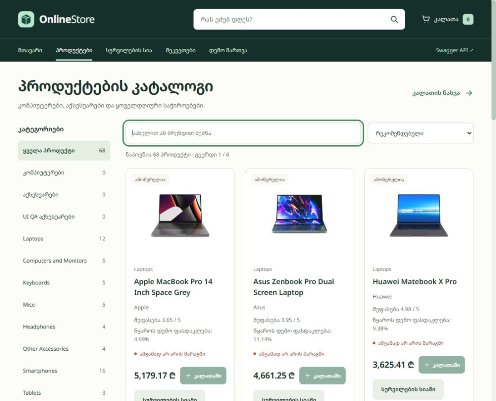

# OnlineStore

ტექნოლოგიური პროდუქტების ონლაინ მაღაზია - უნივერსიტეტის ფინალური პროექტი. მოიცავს ვებინტერფეისს, REST API-სა და SQL Server მონაცემთა ბაზას.

**ონლაინ დემო:** [OnlineStore](https://onlinestore-nikagamkhitashvili.onrender.com/) — Render Free + MonsterASP.NET SQL Server. უმოქმედობის შემდეგ პირველი გახსნა შეიძლება დაგვიანდეს.

**ტექნოლოგიები:** C# · .NET 10 · ASP.NET Core Web API · Entity Framework Core · SQL Server · HTML/CSS/JavaScript · Swagger



## შესაძლებლობები

- პროდუქტების კატალოგი, ძებნა, ფილტრები, დალაგება და ფოტოგალერეა.
- კალათა, სურვილების სია, შეკვეთები და მარაგის კონტროლი.
- პროდუქტების, კატეგორიებისა და მომხმარებლების მართვა; შეკვეთის სტატუსები.
- DummyJSON-ის ტექნოლოგიური კატალოგის იმპორტი და ვალუტის კურსების ინტეგრაცია.

სამფენიანი არქიტექტურა: **API** - HTTP და frontend; **Core** - მოდელები და კონტრაქტები; **Infrastructure** - EF Core, მონაცემთა ბაზა და გარე სერვისები.

## გაშვება

საჭიროა Windows, .NET 10 SDK და SQL Server. Visual Studio 2026-ში გამოიყენეთ **ASP.NET and web development** workload.

SQL Server-ის კავშირი მითითებულია `OnlineStore.API/appsettings.json`-ში და იყენებს Windows Authentication-ს:

```text
Server=localhost;Database=OnlineStoreDb;Trusted_Connection=True;TrustServerCertificate=True;
```

რეპოზიტორიის საქაღალდეში გაუშვით:

```powershell
dotnet tool restore
dotnet restore OnlineStore.sln
dotnet build OnlineStore.sln --no-restore
dotnet ef database update --project OnlineStore.Infrastructure --startup-project OnlineStore.API
dotnet run --project OnlineStore.API --launch-profile https --no-build
```

Visual Studio-ში გახსენით `OnlineStore.sln`, Startup Project-ად აირჩიეთ **OnlineStore.API** და გაუშვით **https** პროფილით.

**მაღაზია:** [https://localhost:7156](https://localhost:7156/) · **Swagger:** [https://localhost:7156/swagger](https://localhost:7156/swagger)

Development რეჟიმში საწყისი დემო მონაცემები ავტომატურად ემატება. დამატებითი პროდუქტების ჩასატვირთად `/admin` გვერდზე გამოიყენეთ **DummyJSON სინქრონიზაცია**. განმეორებითი იმპორტი დუბლიკატებს არ ქმნის და მაღაზიის ფასებსა და მარაგს ინარჩუნებს.

ეს სასწავლო დემოა: ადმინისტრირება, მომხმარებლები და შეკვეთები ადმინისტრატორის შესვლითაა დაცული; რეალური გადახდა არ ხდება. შესვლისთვის დააყენეთ `Admin__Username` და ძლიერი `Admin__Password` მხოლოდ გარემოს საიდუმლო კონფიგურაციაში. იმპორტირებული პროდუქტების მარაგს ადმინისტრატორი მართავს; ახალი ფოტოები ინტერნეტს მოითხოვს. ჰოსტინგი: [Render-ის ინსტრუქცია](DEPLOYMENT_RENDER.md).

## ტესტირება

```powershell
dotnet test OnlineStore.sln
node --test scripts/cart-tests.mjs scripts/product-image-tests.mjs scripts/catalog-tests.mjs
```

ბოლო შემოწმება: **77 .NET და 16 JavaScript ტესტი წარმატებულია**. SQL ტესტები იზოლირებულ დროებით ბაზებს იყენებს; საჭიროა მათი შექმნა/წაშლის უფლება. Node.js მხოლოდ JavaScript ტესტებისთვისაა საჭირო.

დეტალები: [მოთხოვნების checklist](FINAL_REQUIREMENTS_CHECKLIST.md) · [DummyJSON ინტეგრაცია](DUMMYJSON_INTEGRATION.md) · [პროექტის პრეზენტაცია](PROJECT_PRESENTATION.md) · [ფოტოების წყაროები](OnlineStore.API/wwwroot/images/products/credits.html)
